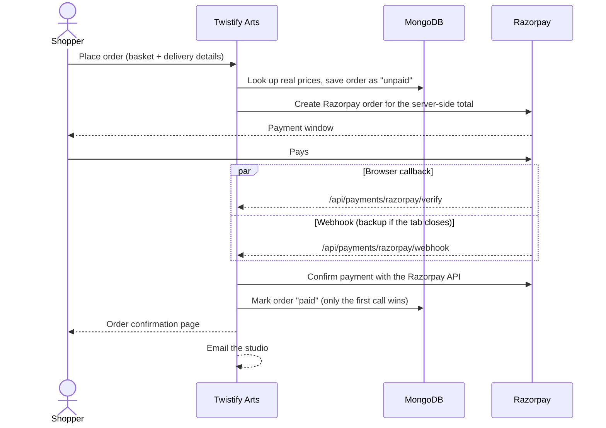

<div align="center">


### Handmade crochet and woolen crafts, made to order by Shraddha Doshi

An online storefront for flower garlands, floral necklaces, LED flower lamps, pooja wall decor and keychains,
with accounts, a basket, Razorpay checkout and an admin order dashboard.


</div>

---

## Contents

- [Run it in 60 seconds](#run-it-in-60-seconds)
- [What's inside](#whats-inside)
- [Tech stack](#tech-stack)
- [Full setup](#full-setup-accounts-orders-payments)
- [Environment variables](#environment-variables)
- [How checkout works](#how-checkout-works)
- [Scripts](#scripts)
- [Project structure](#project-structure)
- [Deploying](#deploying)
- [Troubleshooting](#troubleshooting)
- [Roadmap](#roadmap)
- [Credits](#credits)

---

## Run it in 60 seconds

You need **[Node.js 20.9 or newer](https://nodejs.org/)** and Git. Works on Windows, macOS and Linux. Nothing needs compiling.

```bash
git clone https://github.com/purvdoesmagic/Twistify-arts.git
cd Twistify-arts
npm install
npm run dev
```

Open **http://localhost:3000**. That's it: no `.env` file and no database needed to browse.

> [!NOTE]
> Without a database the shop serves the bundled catalog from [`app/data/products.ts`](app/data/products.ts).
> Sign-up, login and checkout show a friendly "not available yet" notice instead of crashing.
> Add a MongoDB connection string when you want those to work ([full setup](#full-setup-accounts-orders-payments)).

---

## What's inside

**For shoppers**

- 🛍️ **Shop** with category filters, search, sort by price or name, "hide sold out", and a budget finder
- 🧶 **Product pages** with breadcrumbs, availability (*In stock*, *Made to order*, *Sold out*), delivery and returns details, and related pieces
- 🧺 **Basket** saved in the browser, capped at 10 per piece and 20 pieces per order (the same limits are enforced on the server)
- 💳 **Checkout** with Razorpay, plus Indian phone number and PIN code validation
- 👤 **Accounts**: sign up, log in, forgot / reset password by email, order history
- 📄 **Help pages**: About, Contact, FAQ, and shipping, refund, privacy and terms policies

**For the studio**

- 📦 **Admin dashboard** at `/admin`: every order with customer, items, payment and fulfilment status
- 🚚 **Fulfilment tracking**: pending → confirmed → processing → shipped → delivered (or cancelled)
- ✉️ **Order emails** to the studio through Gmail or Resend

**Under the hood**

- 🔒 Prices are recalculated on the server, so a tampered basket can't change what's charged
- 🔁 Payments are confirmed by both the browser callback **and** the Razorpay webhook, idempotently, so a paid order is never missed or double-counted
- ✅ Webhook signatures checked with HMAC-SHA256 and a constant-time comparison
- 🔑 Passwords hashed with bcrypt; reset links are stored hashed and expire after one hour
- 🔎 SEO: sitemap, robots.txt, Open Graph image, Product and FAQ structured data
- ♿ Smooth scrolling and motion (Lenis + GSAP) that respect the *reduce motion* setting

---

## Tech stack

| Layer | Choice |
|---|---|
| Framework | [Next.js 16](https://nextjs.org/) (App Router) + [React 19](https://react.dev/) |
| Language | TypeScript 5 |
| Styling | [Tailwind CSS 4](https://tailwindcss.com/) |
| Motion | [GSAP](https://gsap.com/) + [Lenis](https://lenis.darkroom.engineering/) |
| Database | [MongoDB](https://www.mongodb.com/) via [Mongoose 9](https://mongoosejs.com/) |
| Auth | [Auth.js (NextAuth v5)](https://authjs.dev/), email + password, JWT sessions |
| Payments | [Razorpay](https://razorpay.com/docs/) Orders API + webhooks |
| Email | [Nodemailer](https://nodemailer.com/) (Gmail) or [Resend](https://resend.com/) |

---

## Full setup (accounts, orders, payments)

**1. Create your env file**

```bash
cp .env.example .env.local        # Windows PowerShell: Copy-Item .env.example .env.local
```

**2. Fill in the two essentials** (the rest are optional, see the [table below](#environment-variables))

- `MONGODB_URI`: a free [MongoDB Atlas](https://www.mongodb.com/cloud/atlas) cluster works fine
- `AUTH_SECRET`: generate one with

  ```bash
  node -e "console.log(require('crypto').randomBytes(32).toString('base64'))"
  ```

**3. Load the catalog and create your admin**

```bash
npm run seed:products   # copies app/data/products.ts into MongoDB (safe to re-run)
npm run seed:admin      # uses ADMIN_NAME, ADMIN_EMAIL, ADMIN_PASSWORD from .env.local
```

**4. Restart** `npm run dev`, then sign in at **http://localhost:3000/admin/login**.

> [!TIP]
> To test payments, set `RAZORPAY_ENABLED=true` with **test** keys and pay with
> [Razorpay's test card and UPI details](https://razorpay.com/docs/payments/payments/test-card-details/). No real money moves.

---

## Environment variables

All of them live in `.env.local`. [`.env.example`](.env.example) lists every one with comments.

| Variable | Needed for | Notes |
|---|---|---|
| `MONGODB_URI` | Accounts, orders, product DB | Leave unset to browse with the bundled catalog |
| `AUTH_SECRET` | Login sessions | **Required in production.** Dev falls back to a fixed local secret |
| `NEXT_PUBLIC_SITE_URL` | SEO, email links | e.g. `https://your-domain.com`. Defaults to `http://localhost:3000` |
| `RAZORPAY_ENABLED` | Online payment | `true` / `false`. Payment UI only appears when the config below is valid |
| `RAZORPAY_MODE` | Online payment | `test` or `live`; must match the key prefix |
| `RAZORPAY_KEY_ID` | Online payment | `rzp_test_…` or `rzp_live_…` |
| `RAZORPAY_KEY_SECRET` | Online payment | From the Razorpay dashboard |
| `RAZORPAY_WEBHOOK_SECRET` | Payment backup | See [Deploying](#deploying) |
| `GMAIL_USER` / `GMAIL_APP_PASSWORD` | Emails (preferred) | [Create an app password](https://myaccount.google.com/apppasswords) (needs 2-Step Verification) |
| `RESEND_API_KEY` | Emails (alternative) | Used only when Gmail isn't set |
| `ORDER_NOTIFICATION_EMAIL` | Emails | Where new-order alerts go |
| `ORDER_NOTIFICATION_FROM` | Emails via Resend | Sender address, once your domain is verified in Resend |
| `ADMIN_NAME` / `ADMIN_EMAIL` / `ADMIN_PASSWORD` | `seed:admin`, `reset:admin` | Only read by the scripts, never by the website |

> [!CAUTION]
> `.env.local` holds your secrets and is git-ignored. Never commit it or share it in chats or screenshots.

---

## How checkout works



---

## Scripts

| Command | What it does |
|---|---|
| `npm run dev` | Dev server with hot reload on http://localhost:3000 |
| `npm run build` | Production build |
| `npm start` | Serve the production build |
| `npm run lint` | Check the code with ESLint |
| `npm run seed:products` | Upsert the catalog from `app/data/products.ts` into MongoDB |
| `npm run seed:admin` | Create the admin account from `ADMIN_*` |
| `npm run reset:admin` | Reset the admin's password to `ADMIN_PASSWORD` |
| `npm run migrate:orders` | One-off: update order indexes on databases created before pending orders existed |

---

## Project structure

```text
twistify-arts/
├── app/
│   ├── shop/ cart/ checkout/ account/ admin/ …   pages (one folder per route)
│   ├── api/                 auth, products, admin orders, Razorpay order / verify / webhook
│   ├── components/          header, footer, catalog, basket, checkout form, …
│   ├── data/products.ts     the catalog (source for seeding and no-database mode)
│   ├── lib/                 payments, emails, basket limits, formatting
│   └── models/              Mongoose models: Product, Order, User
├── lib/mongodb.ts           cached database connection
├── auth.ts, auth.config.ts  Auth.js setup
├── proxy.ts                 guards /account and /admin (Next 16's name for middleware)
├── scripts/                 seed, admin and migration scripts
├── public/                  logo and artwork
└── docs/                    roadmap and gap analysis
```

**Editing products:** change [`app/data/products.ts`](app/data/products.ts), then run `npm run seed:products`.

---

## Deploying

[Vercel](https://vercel.com/) is the simplest host for Next.js; any Node.js host works too.

1. Import the repo and add every variable from [the table](#environment-variables) in the host's settings.
   Set `NEXT_PUBLIC_SITE_URL` to your real domain, or the sitemap and email links will point at localhost.
2. In MongoDB Atlas → *Network Access*, allow your host's IPs (or `0.0.0.0/0` for serverless hosts).
3. In Razorpay → *Settings → Webhooks*, add `https://<your-domain>/api/payments/razorpay/webhook`
   with the events **`payment.captured`** and **`order.paid`**, and put the secret you chose in `RAZORPAY_WEBHOOK_SECRET`.
4. Run `npm run seed:products` and `npm run seed:admin` once against the production database.
5. Switch to `RAZORPAY_MODE=live` with `rzp_live_` keys only after a full test-mode order works end to end.

---

## Troubleshooting

<details>
<summary><b><code>npm install</code> fails or the app won't start</b></summary>

Check `node -v`. It must be **20.9 or newer**. Delete `node_modules` and `.next`, then run `npm install` again.
</details>

<details>
<summary><b>Port 3000 is already in use</b></summary>

Run on another port: `npm run dev -- -p 3001`.
</details>

<details>
<summary><b>"Not available yet" on login, sign-up or checkout</b></summary>

That's expected without a database. Set `MONGODB_URI` in `.env.local` and restart the dev server.
</details>

<details>
<summary><b>Can't connect to MongoDB / timeouts</b></summary>

In Atlas, add your current IP under *Network Access*, and check the username and password in the URI
(special characters in the password must be URL-encoded).
</details>

<details>
<summary><b>The payment button doesn't show</b></summary>

All of these must be true: `RAZORPAY_ENABLED=true`, `RAZORPAY_MODE` is `test` or `live`, the key starts with the
matching `rzp_test_` / `rzp_live_` prefix, and the key secret is set. Restart after editing `.env.local`.
</details>

<details>
<summary><b>Emails aren't arriving</b></summary>

For Gmail, `GMAIL_APP_PASSWORD` must be a 16-character **app password**, not your normal password. Check spam too.
Orders still go through without email; only the notification is skipped.
</details>

<details>
<summary><b>Logged in, but <code>/admin</code> sends me home</b></summary>

Your account is a customer account. Admins are created only with `npm run seed:admin`.
</details>

---

## Roadmap

What's planned next, ranked by impact (real product photos, guest checkout, customer receipts, order tracking,
reviews and more), is in **[docs/STOREFRONT_GAP_ANALYSIS.md](docs/STOREFRONT_GAP_ANALYSIS.md)**.

---

## Credits

- **Crafts:** Shraddha Doshi, Twistify Arts
- **Artwork:** public-domain and Creative Commons images; sources and licences are listed in
  [`public/art/credits.json`](public/art/credits.json) and credited on the site

<div align="center">
<sub>Made with yarn, patience and a lot of tiny stitches 🧶</sub>
</div>
